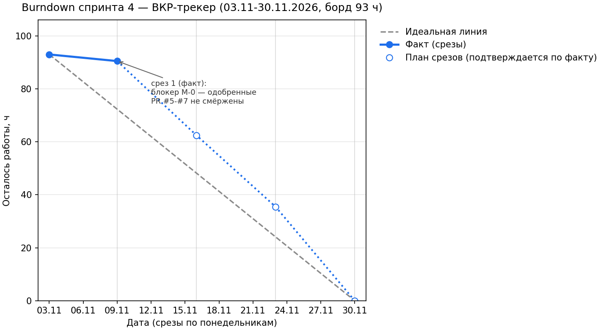

# Burndown спринта 4 — ВКР-трекер (Product/VO)

Спринт 4: 03.11–30.11.2026 (недели 7–10, 28 дней). Владелец документа:
Product/VO. Вопрос спринта: Production-ready?

Правило спринта: burndown не врёт — врут оценки. Отклонение от идеальной
линии — повод для решения на синхре, не для паники и не для рисования
задним числом: срез вносится по факту, источником факта является состояние
репозитория и PR на дату среза.

## 1. Как ведётся burndown

- Борд спринта собран и зафиксирован один раз (таблица ниже): задачи
  разбиты, оценены в часах. Оценки — из трудоёмкости шагов лабы 4 по ролям
  и задач S4-1…S4-7 из `iteration-notes.md`. Пересчёт оценки — явной
  правкой, не молча.
- Срез — каждый понедельник на синхре: 09.11, 16.11, 23.11, 30.11.
  «Выполнено» = то, что проверено по DoD (`quality/dod.md`), а не
  «вроде готово».
- Данные срезов вносятся в `burndown-data.csv` (дата, остаток, тип,
  комментарий), график перегенерируется одной командой:
  `python scripts/burndown_chart.py` → `docs/burndown.png`.
- Скорость команды ≈ 23 ч/нед (4 роли × 5–6 ч). Борд 93 ч на 4 недели —
  впритык, без резерва: это зафиксировано как риск (§5), а не спрятано.

## 2. Борд спринта 4: задачи разбиты и оценены (93 ч)

| ID | Задача | Владелец | Оценка, ч | Источник | План | Статус на 12.11 |
|---|---|---|---:|---|---|---|
| M-0 | Смёржить одобренные PR #5, #6, #7 (порядок: #5 → #6 → #7 → #10) | Product (координация) | 0,5 | приёмка-1 (`acceptance.md`) | нед. 3 | открыта — блокер |
| D-1 | Каркас таблиц цикла по UC-01/UC-06 в общей БД (ADR-005) | Delivery | 8 | R1, S4-1 | нед. 3–4 | заблокирована M-0 |
| DEL-1 | Каркас UI + compose + прод: E2E трекерной части | Delivery | 6 | S4-2, DoD лабы 3 | нед. 3 | заблокирована M-0 |
| DEL-2 | CI/CD до прода: deploy.yml, автодеплой на мёрж, откат одной командой | Delivery | 5 | лаба 4, шаг 1 | нед. 4 | не начата |
| DEL-3 | Staging ≈ prod: compose.staging.yml + environments.md | Delivery | 3 | лаба 4, шаг 2 | нед. 3 | не начата |
| DEL-4 | Мониторинг: Grafana, трейсы LLM в общий контур, дашборд на один экран | Delivery | 5 | лаба 4, шаг 3 | нед. 4 | не начата |
| DEL-5 | Лимиты и границы: backend/limits/ + backend/guards/, алерт расхода | Delivery | 4 | лаба 4, шаг 4; PRD v3 | нед. 4 | не начата |
| DEL-6 | Миграции SQLite → общая БД, объединение схем | Delivery + AI | 4 | S4-7 | нед. 4 | заблокирована M-0 |
| A-1 | Экспорт approved-тем (GET /api/export/xlsx) | AI | 2,5 | R4, S4-3 | нед. 3 | заблокирована M-0 |
| A-2 | Подтверждение темы: approve с записью решения | AI | 1,5 | R5, S4-3 | нед. 3 | заблокирована M-0 |
| AI-2 | ai-pipeline.md v2 + openapi дополнен (gate двухсостояний) | AI + Product | 2 | R3, S4-4 | нед. 4 | не начата |
| AI-3 | Тексты причин gate на языке пользователя | AI + Product | 1 | R8, S4-6 | нед. 4 | не начата |
| AI-4 | Промпты v2 по «где врём»: итерации, evals до/после | AI | 6 | eval-report-1 (E3/E4); лаба 4, шаг 1 | — | ✅ 11.11 (PR #10) |
| AI-5 | A/B: сценарии в коде, результаты в репо, записка | AI | 4 | лаба 4, шаг 2 | — | ✅ 11.11 (PR #10) |
| AI-6 | Оптимизация стоимости: кэш + сокращение контекста, цифры до/после | AI | 4 | лаба 4, шаг 3 | — | ✅ 11.11 (PR #10) |
| AI-7 | Инструмент модели: контракт, таймаут, минимальные права | AI | 3 | лаба 4, шаг 4 | — | ✅ 11.11 (PR #10) |
| AI-8 | ADR по итогам месяца с «Ценой решения» | AI | 1,5 | лаба 4, шаг 5 | — | ✅ 11.11 (PR #10) |
| QA-1 | Полный live-прогон evals ≥ 20 кейсов, golden dataset v2, порог CI по факту | Quality | 6 | S4-5, eval-report-1 | нед. 3 | заблокирована M-0 |
| QA-2 | Quality-gates в CI с порогами (quality-gates.yml) | Quality | 3 | лаба 4, шаг 1 | нед. 3 | не начата |
| QA-3 | Прогон атак по threat model, security-report-1 | Quality | 5 | лаба 4, шаг 2 | нед. 4 | не начата |
| QA-4 | Интеграционные тесты критических UC + лимитов и деградации | Quality | 3 | лаба 4, шаг 3 | нед. 4 | не начата |
| QA-5 | Закрытие пробившихся атак + повторный прогон, security-report-2 | Quality | 2 | лаба 4, шаг 4 | нед. 4 | не начата |
| P-1 | Burndown: борд, оценки, срезы, график (ведётся весь спринт) | Product | 4 | лаба 4, шаг 1 | нед. 1–2 | ✅ 12.11, ведётся |
| P-2 | Фиксация MVP-скоупа: в скоупе и вырезанное — с причинами | Product | 3 | лаба 4, шаг 2 | нед. 2 | ✅ 12.11 (этот PR) |
| P-3 | Еженедельная приёмка по DoD (4 синха) + файл DoD | Product | 3 | лаба 4, шаг 3 | весь спринт | 1 из 4 приёмок |
| P-4 | Требования v3: PRD + UC | Product | 3 | лаба 4, шаг 4 | нед. 2 | ✅ 12.11 (этот PR) |

Итог по владельцам: Delivery 35, AI 25,5, Quality 19, Product 13,
координация M-0 0,5 — **93 ч**.

Заметка об оценках: AI-4…AI-8 закрыты за одну сессию 11.11 одним PR —
фактическая скорость AI оказалась выше оценки. Это принимается как факт
(не «рисуем burn»), экономия идёт в резерв недели 4 у Delivery, а не в
новые фичи: добавление скоупа в середине спринта запрещено
(`mvp-scope.md`).

## 3. Срезы (вносится по факту синхры)

| Дата | Выполнено за неделю, ч | Осталось, ч | Факты и решения |
|---|---:|---:|---|
| 03.11 (старт) | 0 | 93 | Борд зафиксирован. Граница спринтов: долг лабы 3 закрыт 07.11 (PR #9, validation-log + ответ в PR #8) — вход спринта, не burn спринта 4 |
| 09.11 (срез 1, факт) | 2,5 | 90,5 | Приёмка-1 (`acceptance.md`); борд и оценки спринта. **Отклонение → задача M-0**: одобренные PR #5–#7 не смёржены, контурные задачи (D-1, DEL-1/3/6, QA-1, A-1/A-2) не стартуют |
| 16.11 (срез 2, план) | 28 | 62,5 | AI-4…AI-8 — PR #10 (факт 11.11, коммиты bbb506c и ed15a09); P-1, P-2, P-4 — PR лабы 4 Product. Приёмка-2: выбор промпта по цифрам A/B, мерж одобренных PR (M-0) |
| 23.11 (срез 3, план) | 27 | 35,5 | M-0 закрыта; D-1, DEL-1, DEL-3, QA-1, QA-2, A-1, A-2 |
| 30.11 (срез 4, план) | 35,5 | 0 | DEL-2/4/5/6, QA-3/4/5, AI-2, AI-3; финальная приёмка по DoD лабы 4 |

## 4. График

Сплошные точки — фактические срезы; полые — план срезов 2–4, подтверждается
по факту на синхрах; серый пунктир — идеальная линия. Данные:
`burndown-data.csv`.

## 5. Отклонения — решения, а не паника

1. **M-0 — главное отклонение среза 1.** Одобренные PR #5, #6, #7 не
   смёржены: контурные задачи спринта не стартуют, и две недели из четырёх
   сгорают впустую. Решение (приёмка-1): мерж — первый пункт синха-2,
   координирует Product. Известный риск: `database/schema.sql` добавлен
   в PR #5, #6 и #7 тремя версиями — при мерже потребуется разрешение
   конфликта; владелец интеграции схем — Delivery (DEL-6, S4-7).
2. **Перегруз Delivery в плане недели 4** (20 из 35,5 ч недели: D-1 4 +
   DEL-2 5 + DEL-4 5 + DEL-5 4 + половина совместной DEL-6 2). Решение:
   контроль на срезе 3; при отставании DEL-4 режется до минимального
   дашборда (метрики + логи + алерт расхода), полный контур трейсов —
   вехой позже. Правило спринта: вырезать фичу — решение, а не поражение.
3. **Оценки vs факт у AI.** AI-4…AI-8 закрыты одним PR быстрее оценки —
   факт принимается в burndown на срезе 2, экономия — в резерв Delivery
   (п. 2), не в расширение скоупа.

## 6. Честная граница

Срезы 2–4 на дату 12.11 — план (полые точки на графике), не факт: каждый
подтверждается на синхре и вносится в `burndown-data.csv` по факту.
Критерий DoD «burndown вёлся весь спринт» проверяется на приёмке 30.11
(`acceptance.md`, приёмка 4).
